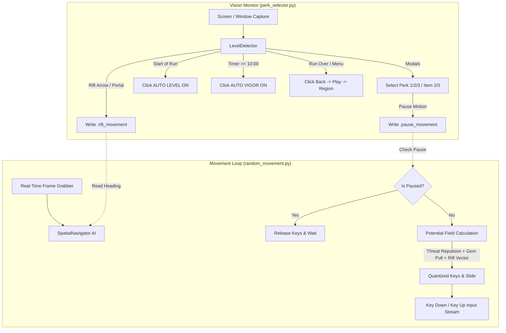

# PokéLit AFK Bot: Autonomous Spatial AI, Vision Monitor & Infinite Loop

[](https://www.python.org/)
[-brightgreen.svg)]()
[]()
[]()

A state-of-the-art, fully autonomous bot for **[PokéLit](https://pokelit.com/)** (browser-based 2D survivor rogue-lite). Features real-time **Spatial Potential Field AI navigation**, dynamic **30 FPS compass arrow and portal tracking**, automated perk/modal handling, **Auto Vigor** and **Auto Level** management, and an **infinite match restart loop**.

Designed to run seamlessly on both **Windows** (with background window isolation via Win32 `PrintWindow` and `PostMessage`) and **Linux** (including **CachyOS**, Arch Linux, and Ubuntu via `mss`, `PyAutoGUI`, and `pynput`).

---

## Table of Contents

- [Key Features](#key-features)
  - [1. Real-Time Spatial AI Navigation & Kiting](#1-real-time-spatial-ai-navigation--kiting)
  - [2. Top-Priority Rift Portal Navigation](#2-top-priority-rift-portal-navigation)
  - [3. Modals, Perk Selection & In-Game Automation](#3-modals-perk-selection--in-game-automation)
  - [4. Infinite AFK Match Restart Loop](#4-infinite-afk-match-restart-loop)
  - [5. Cross-Platform Engine (Windows & Linux)](#5-cross-platform-engine-windows--linux)
- [System Architecture](#system-architecture)
- [Installation](#installation)
  - [CachyOS / Arch Linux Setup](#cachyos--arch-linux-setup)
  - [Ubuntu / Debian Setup](#ubuntu--debian-setup)
  - [Windows Setup](#windows-setup)
- [Different Laptop & Screen Dimensions](#different-laptop--screen-dimensions)
- [How to Run](#how-to-run)
- [Controls & Hotkeys](#controls--hotkeys)
- [Configuration Reference (`config.json`)](#configuration-reference-configjson)
- [Verification & Automated Tests](#verification--automated-tests)
- [Troubleshooting & Linux Notes](#troubleshooting--linux-notes)

---

## Key Features

### 1. Real-Time Spatial AI Navigation & Kiting
- **Radial Swarm Avoidance**: Continuously computes obstacle and enemy repulsion vectors across 8 angular sectors ($r \in [35, 160]\,\text{px}$) around the player.
- **Pro-Player Kiting & Strafing**: Applies dynamic tangential rotational force to gracefully circle around elite swarms and bosses while abilities fire automatically into the mob center.
- **XP Gem Vacuum**: Locates gold, amber, blue, and green XP gems across the arena. Uses dominant cluster grouping to eliminate vector cancellation (no getting stuck between two opposite gems).
- **Sub-Pixel Terrain Motion Tracking**: Employs phase correlation (`cv2.phaseCorrelate`) on ground terrain patches to measure real physical displacement.
- **Autonomous Obstacle Escape Slides**: If blocked by trees, rocks, or corners, the bot triggers orthogonal ($\pm 90^\circ$ or $135^\circ$) sliding vectors to slip past obstacles.
- **Opposing Key Lockout & Ghost Flush**: Automatically releases conflicting keys (`s` when `w` is active) and purges stale browser key states every second.

### 2. Top-Priority Rift Portal Navigation
- **Dynamic 30 FPS Compass Tracking**: Continuously monitors the rotating perimeter purple compass arrow and distance label across the entire playfield height ($y \in [0, 615]$). As the character runs across the map, the steering vector recalculates dynamically on every frame to turn along the arrow.
- **Physical Portal Tear Morphology Detection**: Accurately recognizes genuine rift tear geometry ($ph \ge 85\,\text{px}, pw \ge 45\,\text{px}, \text{AR} \in [1.25, 2.8]$, void core ratio, and violet aura) while filtering out purple enemy mobs (Nidoking, Nidoran, Gengar).
- **100% Priority Plunge**: The moment a rift arrow or portal tear is detected, the AI immediately suspends random movement and kiting to plunge straight into the portal coordinates.
- **Heading Persistence Memory**: Retains active rift heading through brief modal transitions or particle occlusions ($1.5\,\text{s}$ grace window).

### 3. Modals, Perk Selection & In-Game Automation
- **Level-Up Screen ("Choose a reward")**: Selects option **1**, **2**, or **3** according to `choice_strategy` in `config.json`.
- **Item Pickups (2 Options)**: Automatically taps **`2`** (`Equip [Item]`).
- **Item Swaps / Locks (3 Options)**: Automatically taps **`3`** (`Lock [Item]`).
- **Start-of-Level Auto Level**: Checks for the **`AUTO LEVEL`** button at match start and clicks it once to switch from dark yellow to bright yellow ON.
- **Auto Vigor Synchronization**:
  - **Early Game (< 10:00)**: Ensures Auto Vigor remains **OFF** so you can pick optimal perks.
  - **Late Game ($\ge$ 10:00)**: Automatically clicks **`AUTO VIGOR`** to turn it **ON**, allowing uninterrupted rift navigation.

### 4. Infinite AFK Match Restart Loop
- **"Run over" Screen**: Dynamically detects the summary card across both short and tall loot layouts and clicks **`Back to menu`**.
- **Main Lobby**: Clicks **`Play`** (`Enter the dungeon`) to start a new run.
- **Region Selection**: Automatically chooses **`Hoenn`** (or **`Johto`** / **`Kanto`**, configurable via `config.json`).
- **Clean State Reset**: Flushes leftover IPC flags, re-evaluates Auto Level, and starts WASD navigation for the next run.

### 5. Cross-Platform Engine (Windows & Linux)
- **Windows**: Full background window isolation using Win32 `PrintWindow` and `PostMessage`. The bot interacts strictly with the targeted browser handle without interfering with foreground desktop work.
- **Linux (CachyOS / Arch / Ubuntu)**: Universal screen capture via `mss` and cross-platform input simulation via `PyAutoGUI` and `pynput`.

---

## System Architecture



Both threads coordinate via lightweight IPC files:
- `.pause_movement`: Safely halts character movement during perk selection modals.
- `.rift_movement`: Delivers real-time rift coordinates, quantized keys, and exact compass angles.

---

## Installation

### CachyOS / Arch Linux Setup

CachyOS provides bleeding-edge, highly optimized packages. You can install all dependencies either natively via `pacman` (recommended for CachyOS) or in a Python virtual environment:

#### Option A: Native Pacman Packages (Fastest & Cleanest)
```bash
sudo pacman -S --needed \
    python \
    python-pip \
    python-opencv \
    python-numpy \
    python-pyautogui \
    python-pynput \
    python-mss \
    python-pillow \
    python-xlib
```

#### Option B: Virtual Environment (`venv` + `requirements.txt`)
Because Arch Linux and CachyOS enforce [PEP 668](https://peps.python.org/pep-0668/) (externally managed environment), use a virtual environment:
```bash
# 1. Clone repository and enter directory
cd pokelit

# 2. Create and activate a virtual environment
python -m venv .venv
source .venv/bin/activate

# 3. Install dependencies
pip install -r requirements.txt
```

> [!TIP]
> **Wayland vs X11 on CachyOS**:
> If your CachyOS desktop is running **Wayland** (KDE Plasma or GNOME default), global key monitoring (`pynput`) and synthetic clicks (`pyautogui`) require X11 compatibility:
> - **Preferred**: Log into a **Plasma (X11)** or **GNOME (X11)** session from your login manager (SDDM / GDM).
> - **Under Wayland**: Ensure your browser runs under **Xwayland**, or grant your user input device access:
>   ```bash
>   sudo usermod -a -G input $USER
>   ```
>   *(Log out and log back in for changes to take effect).*

---

### Ubuntu / Debian Setup

```bash
# 1. Install system libraries for OpenCV and X11
sudo apt update && sudo apt install -y \
    python3-pip \
    python3-venv \
    python3-tk \
    scrot \
    libx11-dev \
    libxtst-dev

# 2. Create virtual environment and install requirements
python3 -m venv .venv
source .venv/bin/activate
pip install -r requirements.txt
```

---

### Windows Setup

```powershell
# Open PowerShell in the project directory
pip install -r requirements.txt
```

*(On Windows, DPI scaling and Win32 background window hooks are automatically activated at startup).*

---

## Different Laptop & Screen Dimensions

**Yes, the bot works seamlessly across different laptops and screen resolutions!**

- **Normalized Coordinate System**: All vision detection, template matching, and spatial calculations operate on a normalized $1024 \times 640$ coordinate space.
- **Dynamic Coordinate Projection**:
  $$\text{scale} = \frac{\text{Client Width}}{1024.0}$$
  $$\text{Click}_X = \text{Norm}_X \times \text{scale}, \quad \text{Click}_Y = \text{Norm}_Y \times \text{scale}$$
- Whether your laptop display is **1920×1080**, **2560×1440**, **2560×1600**, or **1366×768**, all button clicks and detection bounding boxes scale proportionally.
- **Recommended Browser Setting**: Keep your browser zoom at **100%** (Ctrl + 0) for optimal template matching confidence.

---

## How to Run

### Single Command (Recommended)
Launches both the Vision Monitor and Spatial Movement engine in a unified process:

```bash
python run_all.py
```

### Two Separate Terminals (For Detailed Debugging)
If you want to view the real-time AI kiting/gem vectors and vision detections side-by-side:

```bash
# Terminal 1: Spatial AI Movement Loop
python random_movement.py

# Terminal 2: Vision Monitor (Modals, Rifts, Auto Level & Vigor)
python perk_selector.py
```

Once running, switch to your PokéLit window and press **`[F8]`** to start!

---

## Controls & Hotkeys

| Hotkey | Action | Description |
|---|---|---|
| **`[F8]`** | **Start Bot** | Begins autonomous movement and vision monitoring. |
| **`[F9]`** | **Emergency Stop** | Pauses the bot and releases all active movement keys immediately. |
| **`[F10]`** | **Quit** | Gracefully terminates all bot processes and cleans up IPC flags. |
| **`[F7]`** | **Test Scan** | Runs an instant one-shot vision scan to print current modal/rift state. |
| **Corner Abort** | **Fail-Safe** | Slam your mouse cursor into the top-left screen corner $(0, 0)$ to trigger PyAutoGUI fail-safe abort. |

---

## Configuration Reference (`config.json`)

Customize bot behavior by editing [`config.json`](file:///c:/Users/lucky/pokelit/config.json):

```json
{
  "target_window": {
    "enabled": true,
    "title_keyword": "pokelit",
    "focus_flick_on_select": true
  },
  "movement": {
    "keys": ["w", "a", "s", "d"],
    "min_hold_seconds": 0.8,
    "max_hold_seconds": 2.2
  },
  "level_up": {
    "choice_strategy": "1",
    "confidence_threshold": 0.78
  },
  "item_window": {
    "choice_2_options": "2",
    "choice_3_options": "3"
  },
  "rift_navigation": {
    "enabled": true,
    "confidence_threshold": 0.65
  },
  "auto_level": {
    "enabled": true
  },
  "auto_restart": {
    "enabled": true,
    "region": "hoenn",
    "post_click_delay_seconds": 2.5
  },
  "spatial_ai": {
    "enabled": true,
    "gem_weight": 1.2,
    "threat_weight": 2.4,
    "kite_weight": 0.9,
    "danger_threshold": 12.0
  }
}
```

### Key Options:
- **`auto_restart.region`**: Set to `"hoenn"`, `"johto"`, or `"kanto"` depending on which region you want to farm.
- **`level_up.choice_strategy`**: Which perk button to select on level-up (`"1"`, `"2"`, or `"3"`).
- **`auto_level.enabled`**: Automatically enables in-game Auto Level at the start of each match.
- **`spatial_ai.threat_weight`**: Multiplier for enemy swarm repulsion (increase if taking too much contact damage).
- **`spatial_ai.gem_weight`**: Multiplier for XP gem attraction.

---

## Verification & Automated Tests

The codebase includes an extensive suite of **33 verification tests** validating template matching, modal detection, dynamic arrows, physical portal morphology, unstuck lifecycle, and DPI scaling across multiple resolutions:

```bash
python test_detection.py
```

### Expected Output:
```
[TEST 1] Gameplay: modal=none, rift_active=False
[TEST 2] Level-Up: modal=level_up, options=3
[TEST 5] Rift Pic 1: active=True, keys=['s', 'a'], angle=133.4
[TEST 7b] Rift Arrow Left: active=True, keys=['a'], angle=-175.1
[TEST 8] Physical Portal 1: active=True, mode=portal_tear, keys=['d']
[TEST 10] Auto Vigor: early (active=False) | late (active=True)
[TEST 13] Choose Region: Hoenn click=(485, 293) | Johto click=(365, 293) | Kanto click=(238, 277)
[TEST 20] Obstacle Pinning Detected: mode=unstuck_escape
[TEST 25] Auto Level Start-of-Level Activation & State Transition
[TEST 28] Top Screen Edge Rift (y < 60): active=True, keys=['w', 'd']
[TEST 29] TerrainMotionTracker: Escape auto-terminates safely | Rift push immune
================================================================================
ALL 33 VERIFICATION TESTS PASSED!
================================================================================
```

---

## Troubleshooting & Linux Notes

### 1. PyAutoGUI / pynput Fails on Wayland (CachyOS / Arch)
- **Symptom**: `pynput` does not register hotkeys (`[F8]`, `[F9]`) or `pyautogui` cannot move the cursor.
- **Fix**: Switch your desktop session to **X11** at the login screen (SDDM/GDM). X11 allows cross-window input emulation and global keyboard hooks out of the box.

### 2. Character Stops Moving or Hangs
- If movement pauses unexpectedly, check whether `.pause_movement` exists in the folder. The bot includes an automatic watchdog that expires stale pause flags after $3.0\,\text{s}$. You can also manually delete `.pause_movement` or press **`[F9]`** then **`[F8]`** to reset.

### 3. Template Matching Misses on a Different Browser
- Ensure browser zoom is set to **100%**.
- Check that hardware acceleration is enabled in Brave/Chrome so canvas rendering colors match the standard color palette.

---

## License

This project is licensed under the MIT License. See [LICENSE](LICENSE) for details.
